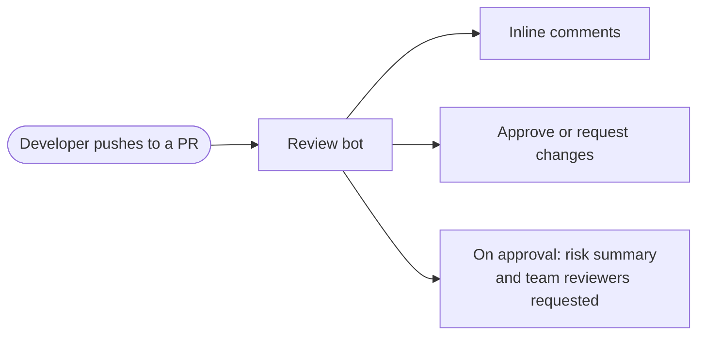
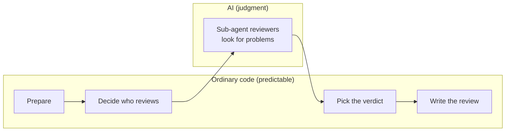
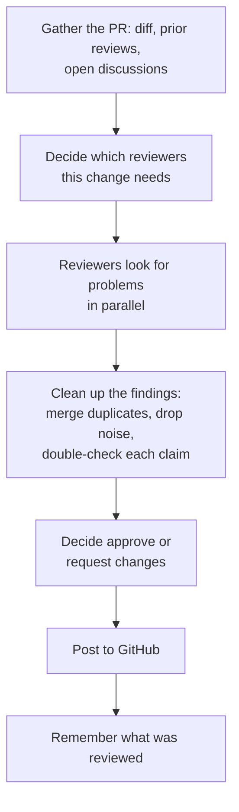
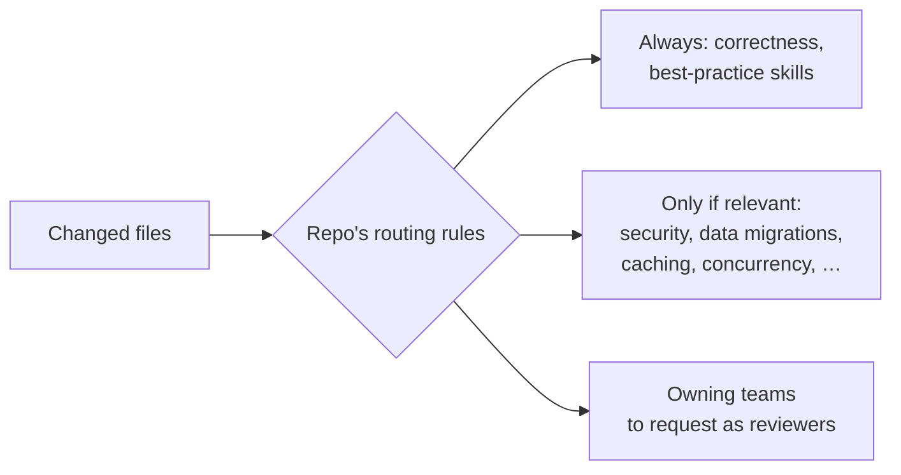
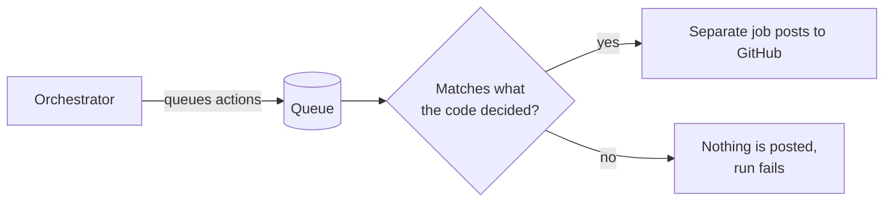
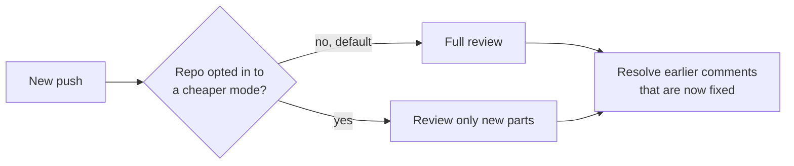
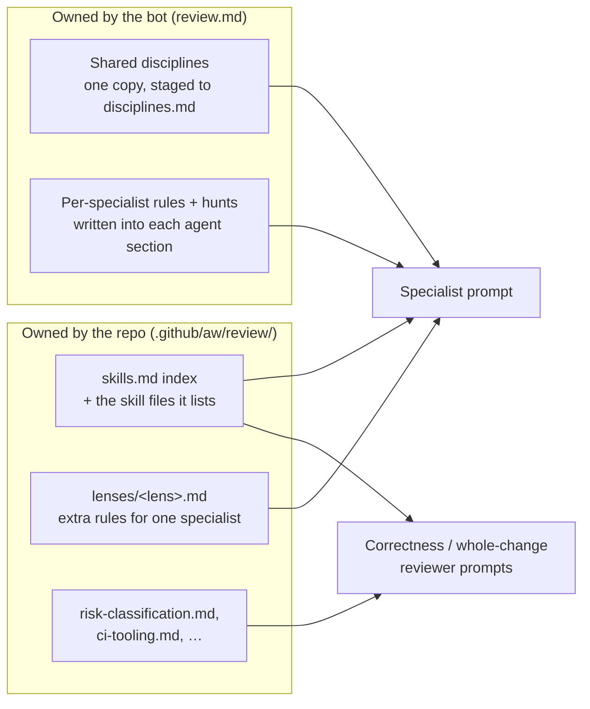

# Review Bot — Architecture

Part 1 explains the bot in plain terms. Part 2 maps each idea to the files and
scripts that implement it. Known problems, each with a possible solution, are collected at the end.

# Part 1 — Overview

## 1.1 What it does

On every push to a pull request, the bot reviews the change and responds the way a
human reviewer would: inline comments, then either an approval or a request for changes.

## 1.2 The core idea: a script runs the review, AI finds the bugs

Most of the bot is ordinary code that follows fixed rules. AI is used only where
judgment is needed: reading code and spotting problems. The **orchestrator** (the
agent gh-aw runs, prompted by `review.md`) coordinates the run, but in practice it
mostly runs the scripts in order and passes their results along. The reviewers
are **sub-agents**: separate AI agents that the scripts start.

## 1.3 One review, start to finish

## 1.4 Who reviews what

A change only gets the specialists it needs. Each repo writes its own rules
for which files need which specialists and how risky each area is.

## 1.5 Safety: the orchestrator cannot post directly

The orchestrator never has permission to write to GitHub. It can only *queue* actions.
A separate check compares that queue with what the code decided, and a separate
job holding the GitHub permissions does the posting.

## 1.6 Later pushes are reviewed more cheaply

The bot remembers what it has already reviewed. By default every push gets a full
review; a repo can opt in to cheaper modes that look at only the new parts. Either
way, it checks whether its earlier comments have been addressed.

## 1.7 Where things live

| Piece | Where |
|---|---|
| Instructions for the orchestrator and the sub-agents | `review.md` (copied into each repo) |
| The code that runs the review | `lib/` in this repo, fetched at run time |
| Per-repo rules (routing, teams, skills, extra specialist rules) | the repo using the bot, mostly under `.github/aw/review/` |
| Testing and measuring the bot's quality | `eval/` (never runs during a real review) |

---

# Part 2 — Mechanisms

## 2.1 One review, mapped to files

The steps in 1.3 run as scripts in `lib/`, in three phases: setup steps before the
orchestrator starts, scripts the orchestrator runs (as instructed by `review.md`), and checks
after it finishes. The scripts pass work along as files on disk (under
`/tmp/gh-aw/review/`). The one direct call is `stage-pr.ts` running the router's
first pass.

Scripts are boxes; files are rounded. Only the main files are shown, and two
smaller after-agent scripts (`cost-report-cli.ts`, `dismiss-review.ts`) are left out.

### File details

Files are under `/tmp/gh-aw/review/` unless noted. Shapes are abbreviated (`…` = more fields).

**Scripts: what each reads and writes**

| Script | Reads | Writes |
|---|---|---|
| `stage-pr.ts` | GitHub API, cache memory | `pr-context.json`, `files.json`, `full.diff`, `threads.json`, `prior-reviews.json`, `provenance.json`, `rereview-plan.json`, … |
| `router.ts` | `files.json`, repo's `ROUTING` / `REVIEWERS` / `.gitattributes` | `routing.json` |
| `dispatch.ts` | `routing.json`, `rereview-plan.json`, diffs, `provenance.json`, threads | `dispatch-result.json`, `out/<agent>.json` |
| `submission.ts` | `dispatch-result.json`, `routing.json`, `rereview-plan.json`, `prior-reviews.json`, cache memory | `submission-plan.json` |
| `dispatch-gate.ts` | `agent_output.json` (queue), `submission-plan.json`, `out/` | pass, or strips the queue and fails |
| `cache-record.ts` | `agent_output.json`, `submission-plan.json`, `dispatch-result.json`, `diff-facts.json`, `pr-context.json` | `cache-memory/pr-N.json` |

**Staged before the orchestrator starts (`stage-pr.ts`, `router.ts`)**

| File | Stores | Shape |
|---|---|---|
| `pr-context.json` | PR metadata (title/description are untrusted author text) | `{number, title, description, author, baseBranch, headSha, isDraft, repo, …}` |
| `files.json` | changed files | `[{path, status, hasPatch}]` |
| `full.diff` | whole PR diff, rebuilt from the GitHub API | unified diff text |
| `threads.json` | this bot's open review threads, with full reply chains | `[{thread_id, path, line, url, comments: [{author, body}]}]` |
| `prior-reviews.json` | this bot's earlier reviews | `[{id, state, body}]` |
| `diff-facts.json` | fingerprints of the diff, used to tell what's been reviewed | `{diffFingerprint, hunkSignature}` |
| `routing.json` | suggested reviewers, owning teams, risk tiers, budget | `{lensesToSpawn, enabledReviewers, teams, perFileTier, generatedFiles, runBudget, pendingRiskQuestions, routingConfig}` |
| `provenance.json` | which lines each file's diff touches | per file `{added, removedAdjacent, removed}`, plus `snap`, `warnings` |
| `full-stripped.diff` | diff minus generated files | unified diff text |
| `full-stripped-annotated.diff` | same, with real line numbers printed (for AI eyes only) | annotated diff text |
| `rereview-plan.json` | how deep this round reviews, and why | `{depth: full\|scoped\|flip-gated\|fast, reasons, …}` |

**Written during the review**

| File | Written by | Stores | Shape |
|---|---|---|---|
| `out/<agent>.json` | `dispatch.ts` | each reviewer's raw output | per agent |
| `dispatch-result.json` | `dispatch.ts` | final findings plus a record of the run | `{depth, dispatched, shed, claims, merges, reconciliation, riskFiles, patterns, perAgent, totalUsd, …}` |
| … each `claims[]` entry | | one finding | `{id, source, path, line, label, subject, discussion, failure_scenario, confidence, …}` |
| `submission-plan.json` | `submission.ts` | exactly what to post | `{event, body, skipSubmission, comments, resolve, reasons, notes}` |
| `/tmp/gh-aw/agent_output.json` | gh-aw, from the orchestrator | the queued GitHub actions | gh-aw safe-output queue |
| `/tmp/gh-aw/cache-memory/pr-N.json` | `cache-record.ts` | memory of this PR across runs | `{timestamp, commitSha, verdict, filesReviewed, issuesFlagged, diffFingerprint, reviewedHunks, wasDraft, …}` |

## 2.2 How reviewers are prompted

Every reviewer's prompt is built from three places: text written into the bot's
`review.md`, files staged by code during the run, and files the repo using the
bot provides. Each sub-agent is defined as a `## agent: <name>` section in
`review.md`, and the repo's files are pulled into those sections with
`{{#runtime-import …}}` lines. gh-aw makes each section available in
`.claude/agents/`, where `dispatch.ts` (`loadAgents`) reads and runs it.

### Three kinds of rules

| | Specialist rules | Repo lens files | Repo skills |
|---|---|---|---|
| Written by | bot authors | repo team | repo team |
| Lives in | `review.md` | `lenses/<lens>.md` | skill files listed in `skills.md` |
| Reaches the prompt | always, built in | pasted in if the file exists | reviewer reads the index, then opens relevant files |
| How strictly applied | reviewer judgment | same as specialist rules | exact rule + exact line must be quoted |
| Severity from | reviewer | reviewer | the skill file (`must` / `should`) |
| Checked by | that specialist | that specialist | owning specialist if running, else `skill-auditor` |

The strictness and severity rows are instructions in the prompts, not checks in
code. `lens-payloads.ts` flags lens files that no reviewer will ever load.

---

# Problems and possible solutions

Each problem is checked against the code; solutions are directions, not designs.

## Rules reach reviewers in too many ways (see 2.2)

**Lens files hold codebase knowledge only the reviewer can see.** They are
pasted into one specialist's prompt, but their content is useful to anyone
writing code. Webapp's only lens file, `lenses/security-auth.md`, lists
trust-boundary rules with file pointers (which request headers may be
trusted, how task-only routes must be gated).
*Solution:* move lens content into the repo's real skills and retire lens files.
Note this makes the rules stricter: skill rules must be quoted exactly to count.

**The skills index duplicates the skills.** `skills.md` repeats each skill's path and adds
bot-only "evaluate when" triggers; the skills themselves (webapp's
`.claude/skills/`, also linked as `.agents/skills`) already describe when they apply.
*Solution:* pick skills from each skill file's own description and drop the index.

**Built-in specialist rules use a different format from skills.**
*Solution:* ship them as built-in skills, so there is one format, one way of
loading rules, and one level of strictness.

## The prompt file is large and repetitive

**All instructions live in one ~3,800-line `review.md`.** The 11 specialist
sections (~840 lines) share one shape (rules, hunts, repo add-ons, output).
*Solution:* generate specialist sections from data.

**The same text is pasted in many places.** The skills index is imported into
13 prompts, and whole-change reviewers (e.g. `skill-auditor`) carry their own
edited copies of the shared disciplines.
*Solution:* stage each once to a file, as `disciplines.md` already is.

## Stale and misleading text

**Comments describe a removed "agent" dispatch mode.** Only `scripted` exists
in code.
*Solution:* delete the references.

**Code comments mostly record history and past incidents** rather than the
current design.
*Solution:* move history to the changelog; keep comments about current behaviour.

## Code structure

**Shared files have no shared types.** Scripts hand off through JSON files, and
the writer usually exports a type (`RoutingJson` in `router.ts`,
`DispatchResult` in `dispatch.ts`), but no other script imports it. Each
reader instead casts the file to its own partial shape, inline. For example,
`submission.ts`, `version-footer.ts` and `cache-record.ts` each declare their own
fragment of `dispatch-result.json`. A writer can rename a field without the
compiler noticing any reader.
*Solution:* one module per handoff file that owns its path, type and reader;
every script imports it.

**Every script rebuilds the same plumbing.** `/tmp/gh-aw/review` is defined
separately in 16 files, `readJson` in 5, and each CLI has its own filesystem type
(`DispatchFs`, `SubmissionFs`, `StagePrFs`, …).
*Solution:* one shared file-access module.

**Files are opened far from the step that owns them.** `routing.json` is opened
by path in 9 modules, `rereview-plan.json` in 8, `dispatch-result.json` in 6,
including helpers like `version-footer.ts` and `investigation-cap.ts`. So any
module can quietly depend on any step's output.
*Solution:* read each file once per script and pass the values down as arguments.

**The review depth has two sources of truth.** `rereview-plan.json` holds it, but
`dispatch.ts` can rewrite that plan (escalation) and also records the depth in
`dispatch-result.json`. Later modules read it from one or the other, e.g.
`version-footer.ts` reads it from `dispatch-result.json`.
*Solution:* make one file authoritative and have every reader use it.

**Helpers live in whichever module needed them first.** Comment-label parsing
(`isBlockingLabel` in `render-comment.ts`, `parseLeadingLabel` in `rereview.ts`)
is imported by `dispatch-gate.ts` and `dispatch-escalation.ts`. The risks comment's
signature (`computeRisksPatternsKey`) lives in `cache-record.ts` but is computed
by `submission.ts`.
*Solution:* move shared helpers into small modules named for what they do.

**Module boundaries follow a line-count rule, not responsibilities.** The five
largest files sit at 992–999 lines, just under a 1,000-line lint cap, and many
modules say in their header that they were split out to stay under it
(`dispatch-agents.ts`, `forwarded-warnings.ts`, `stage-pr-cli.ts`, …).
*Solution:* split by responsibility (e.g. per pipeline stage), then let size follow.

## Possible bugs

**Config warnings may never reach the PR.** Lens-file and ROUTING warnings land
in `routing.json`, and the prompt tells the orchestrator to show them. But
`submission.ts` (which writes the review body the orchestrator must post
exactly) doesn't read them.
*Solution:* confirm, then have `submission.ts` render them.

# Next sections (to be written)

Each will go one level deeper into Part 1: preparing the PR, routing,
the review pipeline, verdict rules, follow-up reviews, and safety checks.
