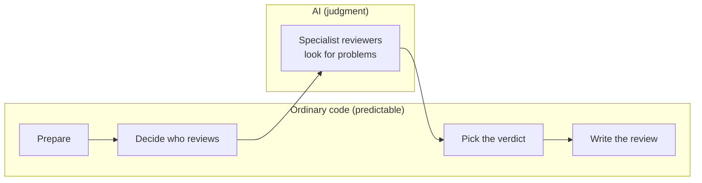
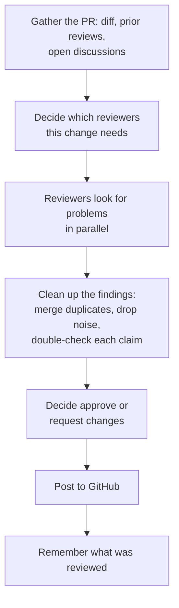
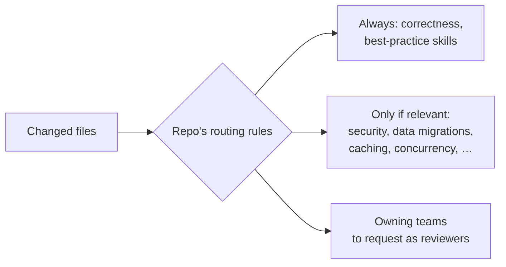
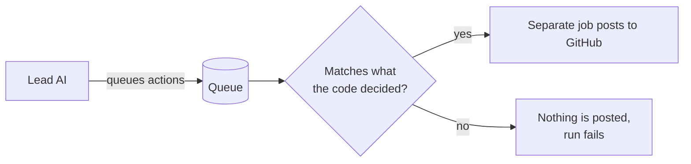
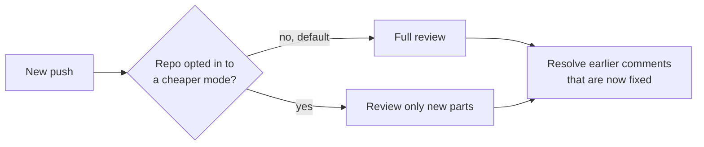
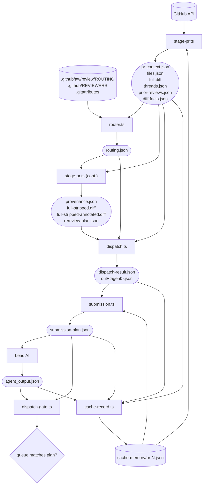
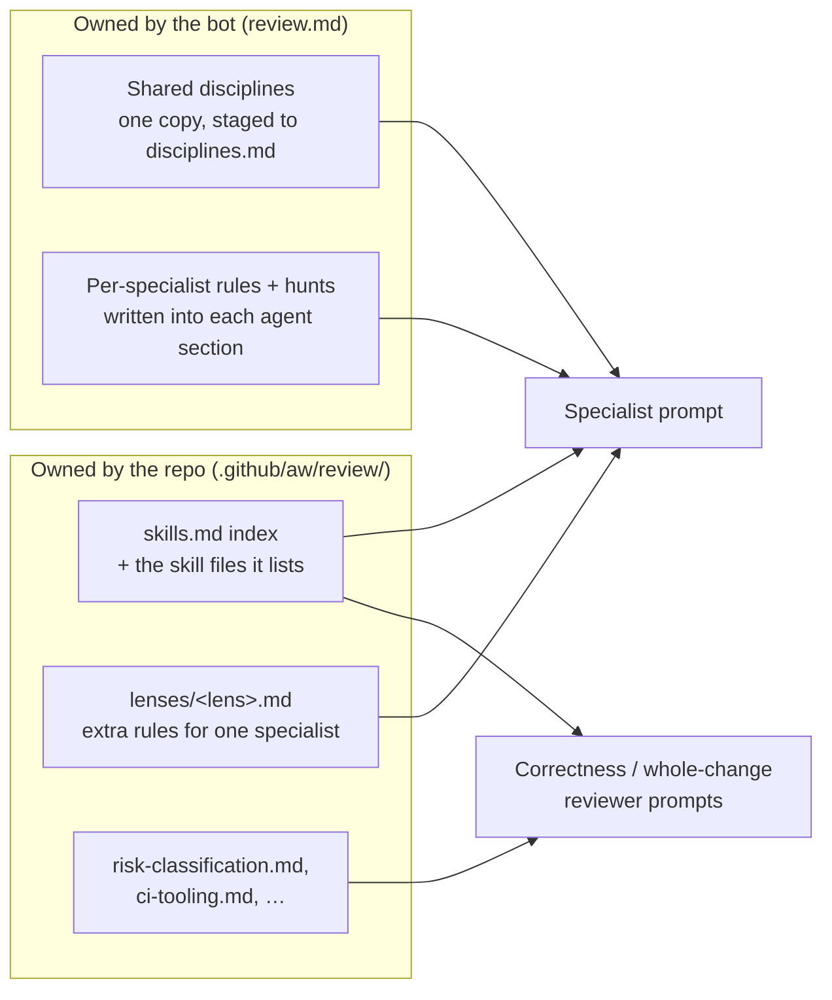

# Review Bot — Architecture

## 1. What it does

On every push to a pull request, the bot reviews the change and responds the way a
human reviewer would: inline comments, then either an approval or a request for changes.

## 2. The core idea: a script runs the review, AI finds the bugs

Most of the bot is ordinary code that follows fixed rules. AI is used only where
judgment is needed: reading code and spotting problems. A lead AI coordinates
the run, but in practice it mostly runs the scripts in order and passes their
results along.

## 3. One review, start to finish

## 4. Who reviews what

A change only gets the specialists it needs. Each repo writes its own rules
for which files need which specialists and how risky each area is.

## 5. Safety: the AI cannot post directly

The AI never has permission to write to GitHub. It can only *queue* actions.
A separate check compares that queue with what the code decided, and a separate
job holding the GitHub permissions does the posting.

## 6. Later pushes are reviewed more cheaply

The bot remembers what it has already reviewed. By default every push gets a full
review; a repo can opt in to cheaper modes that look at only the new parts. Either
way, it checks whether its earlier comments have been addressed.

## 7. Where things live

| Piece | Where |
|---|---|
| Instructions for the lead AI and the specialists | `review.md` (copied into each repo) |
| The code that runs the review | `lib/` in this repo, fetched at run time |
| Per-repo rules (routing, teams) | the repo using the bot |
| Testing and measuring the bot's quality | `eval/` (never runs during a real review) |

## 8. Known messiness

- Only one way of running the specialists exists in code ("scripted"), but comments still describe a removed "agent" mode.
- All specialist instructions live in one very large file (~3,800 lines).
- Code comments often record history and past incidents rather than explaining the design.

---

# Part 2 — Mechanisms

## 2.1 One review, mapped to files

Each step from section 3 is one script in `lib/`. The scripts pass work along as
files on disk (under `/tmp/gh-aw/review/`). The one direct call is `stage-pr.ts`
running the router's first pass.

Scripts are boxes; files are rounded. Only the main files are shown.

### File details

Files are under `/tmp/gh-aw/review/` unless noted. Shapes are abbreviated (`…` = more fields).

**Scripts: what each reads and writes**

| Script | Reads | Writes |
|---|---|---|
| `stage-pr.ts` | GitHub API, cache memory | `pr-context.json`, `files.json`, `full.diff`, `threads.json`, `prior-reviews.json`, `provenance.json`, `rereview-plan.json`, … |
| `router.ts` | `files.json`, repo's `ROUTING` / `REVIEWERS` / `.gitattributes` | `routing.json` |
| `dispatch.ts` | `routing.json`, `rereview-plan.json`, diffs, `provenance.json`, threads | `dispatch-result.json`, `out/<agent>.json` |
| `submission.ts` | `dispatch-result.json`, `routing.json`, `rereview-plan.json`, `prior-reviews.json`, cache memory | `submission-plan.json` |
| `dispatch-gate.ts` | `agent_output.json` (queue), `submission-plan.json`, `out/` | pass, or strips the queue and fails |
| `cache-record.ts` | `agent_output.json`, `submission-plan.json`, `dispatch-result.json`, `diff-facts.json`, `pr-context.json` | `cache-memory/pr-N.json` |

**Staged before the AI starts (`stage-pr.ts`, `router.ts`)**

| File | Stores | Shape |
|---|---|---|
| `pr-context.json` | PR metadata (title/description are untrusted author text) | `{number, title, description, author, baseBranch, headSha, isDraft, repo, …}` |
| `files.json` | changed files | `[{path, status, hasPatch}]` |
| `full.diff` | whole PR diff, rebuilt from the GitHub API | unified diff text |
| `threads.json` | this bot's open review threads, with full reply chains | `[{thread_id, path, line, url, comments: [{author, body}]}]` |
| `prior-reviews.json` | this bot's earlier reviews | `[{id, state, body}]` |
| `diff-facts.json` | fingerprints of the diff, used to tell what's been reviewed | `{diffFingerprint, hunkSignature}` |
| `routing.json` | suggested reviewers, owning teams, risk tiers, budget | `{lensesToSpawn, enabledReviewers, teams, perFileTier, generatedFiles, runBudget, pendingRiskQuestions, routingConfig}` |
| `provenance.json` | which lines each file's diff touches | per file `{added, removedAdjacent, removed}`, plus `snap`, `warnings` |
| `full-stripped.diff` | diff minus generated files | unified diff text |
| `full-stripped-annotated.diff` | same, with real line numbers printed (for AI eyes only) | annotated diff text |
| `rereview-plan.json` | how deep this round reviews, and why | `{depth: full\|scoped\|flip-gated\|fast, reasons, …}` |

**Written during the review**

| File | Written by | Stores | Shape |
|---|---|---|---|
| `out/<agent>.json` | `dispatch.ts` | each reviewer's raw output | per agent |
| `dispatch-result.json` | `dispatch.ts` | final findings plus a record of the run | `{depth, dispatched, shed, claims, merges, reconciliation, riskFiles, patterns, perAgent, totalUsd, …}` |
| … each `claims[]` entry | | one finding | `{id, source, path, line, label, subject, discussion, failure_scenario, confidence, …}` |
| `submission-plan.json` | `submission.ts` | exactly what to post | `{event, body, skipSubmission, comments, resolve, reasons, notes}` |
| `/tmp/gh-aw/agent_output.json` | gh-aw, from the lead AI | the queued GitHub actions | gh-aw safe-output queue |
| `/tmp/gh-aw/cache-memory/pr-N.json` | `cache-record.ts` | memory of this PR across runs | `{timestamp, commitSha, verdict, filesReviewed, issuesFlagged, diffFingerprint, reviewedHunks, wasDraft, …}` |

## 2.2 How reviewers are prompted

Every reviewer's prompt is built from three places: text written into the bot's
`review.md`, files staged by code during the run, and files the repo using the
bot provides. Each `## agent: <name>` section of `review.md` is extracted by gh-aw
into `.claude/agents/`, which `dispatch.ts` loads and runs. The repo's files are
pulled in by `{{#runtime-import …}}` lines, which resolve when the workflow runs.

### Three kinds of rules

| | Specialist rules | Repo lens files | Repo skills |
|---|---|---|---|
| Written by | bot authors | repo team | repo team |
| Lives in | `review.md` | `lenses/<lens>.md` | skill files listed in `skills.md` |
| Reaches the prompt | always, built in | pasted in if the file exists | reviewer reads the index, then opens relevant files |
| How strictly applied | reviewer judgment | same as specialist rules | exact rule + exact line must be quoted |
| Severity from | reviewer | reviewer | the skill file (`must` / `should`) |
| Checked by | that specialist | that specialist | owning specialist if running, else `skill-auditor` |

The strictness and severity rows are instructions in the prompts, not checks in
code. `lens-payloads.ts` flags lens files that no reviewer will ever load.

### Room to consolidate

- **Lens files and skills overlap.** Both are repo-written rules for a domain;
  they differ only in how strictly they're applied. Lens files could become skills
  tagged with a specialist, giving the repo one place for rules.
- **Specialist rules could ship as built-in skills.** The bot's own domain rules
  could use the same format as the repo's, with one loading path and one strictness model.
- **The skills index is pasted into 13 prompts.** It could be staged once, as
  `disciplines.md` already is.
- **The disciplines text is still copied.** Specialists share one copy, but the
  whole-change reviewers (e.g. `skill-auditor`) each carry their own edited copy.
- **The specialist sections all have the same shape** (rules, hunts, repo add-ons,
  output), so the 11 specialist sections (~840 lines) could be generated from data
  instead of near-duplicate prose.

### Open questions

- Lens-file and ROUTING warnings land in `routing.json`, and the prompt tells the
  lead AI to show them on the review. But `submission.ts` (which writes the review
  body the lead AI must post exactly) doesn't appear to read them, so they may
  never reach the PR.

## Next sections (to be written)

Each will go one level deeper into a section above: preparing the PR, routing,
the review pipeline, verdict rules, follow-up reviews, and safety checks.
