# Review Bot — Architecture

Part 1 explains the bot in plain terms. Part 2 maps each idea to the files and
scripts that implement it. Part 3 covers the eval system. The end collects known
problems (each with a possible solution) and options for moving off gh-aw.

# Part 1 — Overview

## 1.1 What it does

On every push to a pull request, the bot reviews the change and responds the way a
human reviewer would: inline comments, then either an approval or a request for changes.

## 1.2 The core idea: a script runs the review, AI finds the bugs

Most of the bot is ordinary code that follows fixed rules. AI is used only where
judgment is needed: reading code and spotting problems. The **orchestrator** (the
agent gh-aw runs, prompted by `review.md`) coordinates the run, but in practice it
mostly runs the scripts in order and passes their results along. The reviewers
are **sub-agents**: separate AI agents that the scripts start.

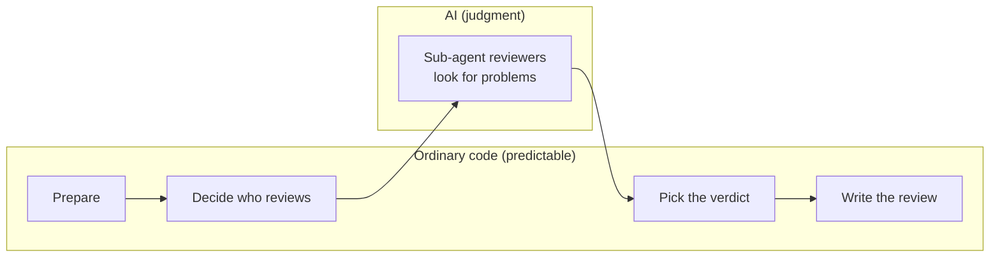

## 1.3 One review, start to finish

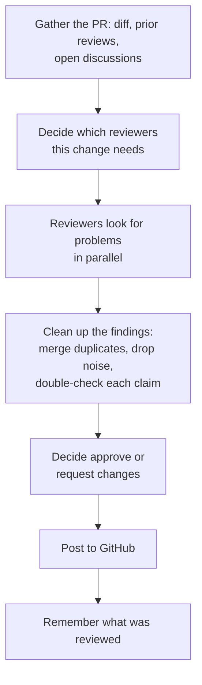

## 1.4 Who reviews what

A change only gets the specialists it needs. Each repo writes its own rules
for which files need which specialists and how risky each area is.

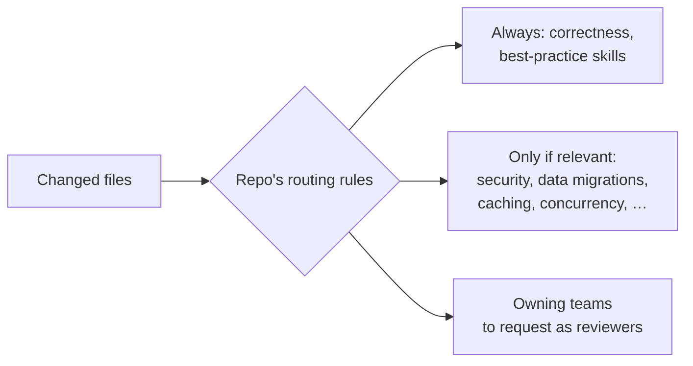

## 1.5 Safety: the orchestrator cannot post directly

The orchestrator never has permission to write to GitHub. It can only *queue* actions.
A separate check compares that queue with what the code decided, and a separate
job holding the GitHub permissions does the posting.

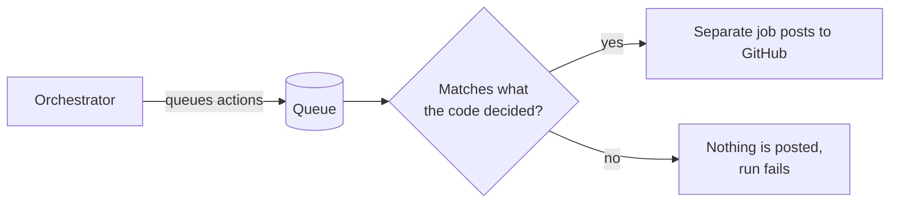

## 1.6 Later pushes are reviewed more cheaply

The bot remembers what it has already reviewed. By default every push gets a full
review; a repo can opt in to cheaper modes that look at only the new parts. Either
way, it checks whether its earlier comments have been addressed.

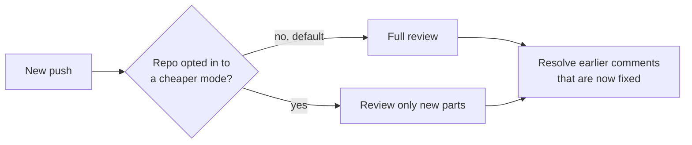

## 1.7 Where things live

| Piece | Where |
|---|---|
| Instructions for the orchestrator and the sub-agents | `review.md` (copied into each repo) |
| The code that runs the review | `lib/` in this repo, fetched at run time |
| Per-repo rules (routing, teams, skills, extra specialist rules) | the repo using the bot, mostly under `.github/aw/review/` |
| Testing and measuring the bot's quality | `eval/` (never runs during a real review) |

---

# Part 2 — Mechanisms

## 2.1 One review, mapped to files

The steps in 1.3 run as scripts in `lib/`, in three phases: setup steps before the
orchestrator starts, scripts the orchestrator runs (as instructed by `review.md`), and checks
after it finishes. The scripts pass work along as files on disk (under
`/tmp/gh-aw/review/`). The one direct call is `stage-pr.ts` running the router's
first pass.

Scripts are boxes; files are rounded. Only the main files are shown, and two
smaller after-agent scripts (`cost-report-cli.ts`, `dismiss-review.ts`) are left out.

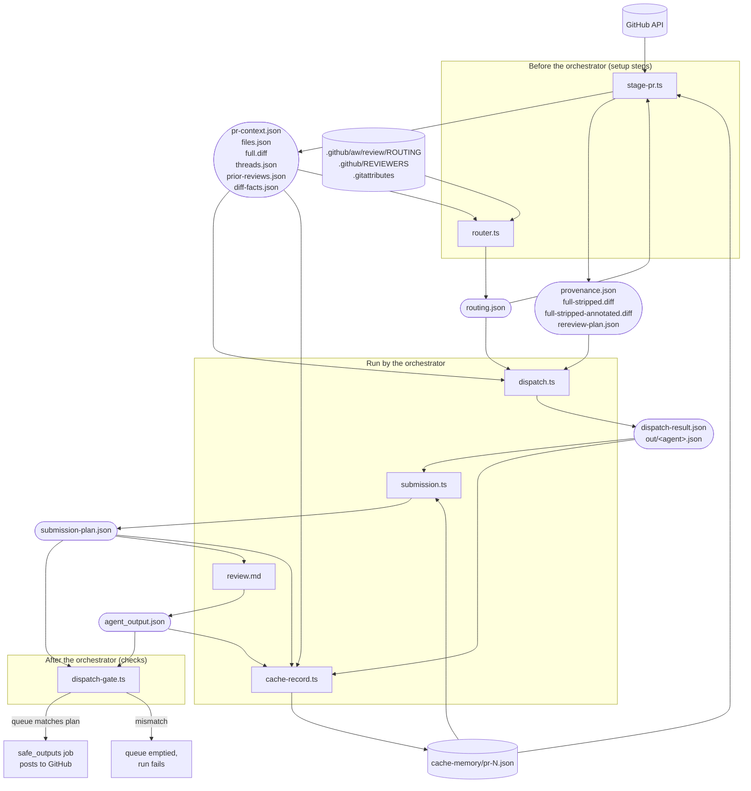

### File details

Files are under `/tmp/gh-aw/review/` unless noted. Shapes are abbreviated (`…` = more fields).

**Scripts: what each reads and writes**

| Script | Reads | Writes |
|---|---|---|
| `stage-pr.ts` | GitHub API, cache memory | `pr-context.json`, `files.json`, `full.diff`, `threads.json`, `prior-reviews.json`, `provenance.json`, `rereview-plan.json`, … |
| `router.ts` | `files.json`, repo's `ROUTING` / `REVIEWERS` / `.gitattributes` | `routing.json` |
| `dispatch.ts` | `routing.json`, `rereview-plan.json`, diffs, `provenance.json`, threads | `dispatch-result.json`, `out/<agent>.json` |
| `submission.ts` | `dispatch-result.json`, `routing.json`, `rereview-plan.json`, `prior-reviews.json`, cache memory | `submission-plan.json` |
| `dispatch-gate.ts` | `agent_output.json` (queue), `submission-plan.json`, `out/` | pass, or strips the queue and fails |
| `cache-record.ts` | `agent_output.json`, `submission-plan.json`, `dispatch-result.json`, `diff-facts.json`, `pr-context.json` | `cache-memory/pr-N.json` |

**Staged before the orchestrator starts (`stage-pr.ts`, `router.ts`)**

| File | Stores | Shape |
|---|---|---|
| `pr-context.json` | PR metadata (title/description are untrusted author text) | `{number, title, description, author, baseBranch, headSha, isDraft, repo, …}` |
| `files.json` | changed files | `[{path, status, hasPatch}]` |
| `full.diff` | whole PR diff, rebuilt from the GitHub API | unified diff text |
| `threads.json` | this bot's open review threads, with full reply chains | `[{thread_id, path, line, url, comments: [{author, body}]}]` |
| `prior-reviews.json` | this bot's earlier reviews | `[{id, state, body}]` |
| `diff-facts.json` | fingerprints of the diff, used to tell what's been reviewed | `{diffFingerprint, hunkSignature}` |
| `routing.json` | suggested reviewers, owning teams, risk tiers, budget | `{lensesToSpawn, enabledReviewers, teams, perFileTier, generatedFiles, runBudget, pendingRiskQuestions, routingConfig}` |
| `provenance.json` | which lines each file's diff touches | per file `{added, removedAdjacent, removed}`, plus `snap`, `warnings` |
| `full-stripped.diff` | diff minus generated files | unified diff text |
| `full-stripped-annotated.diff` | same, with real line numbers printed (for AI eyes only) | annotated diff text |
| `rereview-plan.json` | how deep this round reviews, and why | `{depth: full\|scoped\|flip-gated\|fast, reasons, …}` |

**Written during the review**

| File | Written by | Stores | Shape |
|---|---|---|---|
| `out/<agent>.json` | `dispatch.ts` | each reviewer's raw output | per agent |
| `dispatch-result.json` | `dispatch.ts` | final findings plus a record of the run | `{depth, dispatched, shed, claims, merges, reconciliation, riskFiles, patterns, perAgent, totalUsd, …}` |
| … each `claims[]` entry | | one finding | `{id, source, path, line, label, subject, discussion, failure_scenario, confidence, …}` |
| `submission-plan.json` | `submission.ts` | exactly what to post | `{event, body, skipSubmission, comments, resolve, reasons, notes}` |
| `/tmp/gh-aw/agent_output.json` | gh-aw, from the orchestrator | the queued GitHub actions | gh-aw safe-output queue |
| `/tmp/gh-aw/cache-memory/pr-N.json` | `cache-record.ts` | memory of this PR across runs | `{timestamp, commitSha, verdict, filesReviewed, issuesFlagged, diffFingerprint, reviewedHunks, wasDraft, …}` |

## 2.2 How reviewers are prompted

Every reviewer's prompt is built from three places: text written into the bot's
`review.md`, files staged by code during the run, and files the repo using the
bot provides. Each sub-agent is defined as a `## agent: <name>` section in
`review.md`, and the repo's files are pulled into those sections with
`{{#runtime-import …}}` lines. gh-aw makes each section available in
`.claude/agents/`, where `dispatch.ts` (`loadAgents`) reads and runs it.

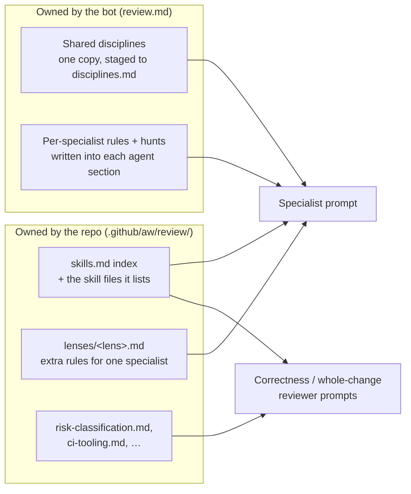

### Three kinds of rules

| | Specialist rules | Repo lens files | Repo skills |
|---|---|---|---|
| Written by | bot authors | repo team | repo team |
| Lives in | `review.md` | `lenses/<lens>.md` | skill files listed in `skills.md` |
| Reaches the prompt | always, built in | pasted in if the file exists | reviewer reads the index, then opens relevant files |
| How strictly applied | reviewer judgment | same as specialist rules | exact rule + exact line must be quoted |
| Severity from | reviewer | reviewer | the skill file (`must` / `should`) |
| Checked by | that specialist | that specialist | owning specialist if running, else `skill-auditor` |

The strictness and severity rows are instructions in the prompts, not checks in
code. `lens-payloads.ts` flags lens files that no reviewer will ever load.

## 2.3 Inside `dispatch.ts`: the sub-agent pipeline

`dispatch.ts` runs every sub-agent and filters their findings in code. There are
23 sub-agents, in four roles:

| Role | Sub-agents | Job |
|---|---|---|
| **Triage** | `pattern-triage` | finds changes repeated across files and narrows the diff to files needing a real review |
| **Finders** | `correctness-reviewer`, `skill-auditor` (always); 11 specialists picked by routing (`security-auth`, `data-migrations`, …); 6 opt-in reviewers (`holistic`, `completeness`, `test-adequacy`, `first-principles`, `conventions`, `documentation`) | look for problems and return findings |
| **Thread follow-up** | `thread-reconciler` | decides which of the bot's earlier open threads the new code has fixed (only runs when there are open threads) |
| **Clean-up** | `claim-clusterer`, `claim-validator` | name findings that describe the same defect; check each claim against the code |

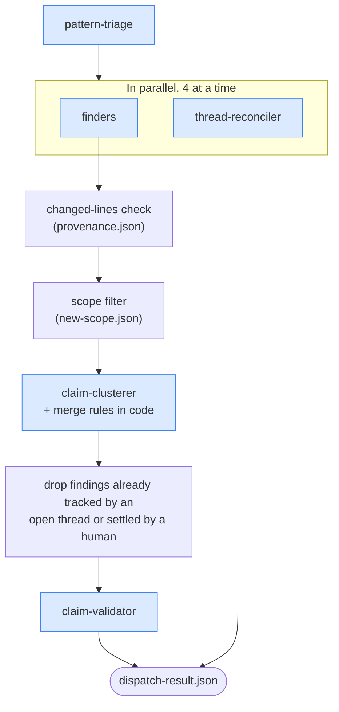

Blue boxes involve sub-agents; the rest is code. `pattern-triage` runs only on full
and scoped reviews, and cheaper re-review depths run fewer finders or none
(`rereview-plan.json`).

---

# Part 3 — Evaluation (`eval/`)

The eval system checks changes to the review bot before they ship. It never runs during
a real review. Its operator guide is `eval/README.md`.

## 3.1 Three tiers

| Tier | What it tests | AI model calls | Entry script | Runs |
|---|---|---|---|---|
| **Replay suite** | the pipeline code, by replaying findings recorded in each case | none | vitest (`*.test.ts`) | every push |
| **Live A/B** | a `review.md` change: real sub-agents from the base and PR versions, scored side by side | sub-agents, judge, match tie-breaker | `live-ab.ts` | PRs touching `workflows/review/**`, plus manual and weekly runs |
| **Judged replay** | comment quality, replaying recorded findings and scoring the rendered comments with a model judge | judge only | `live-judge.ts` | weekly, or the `live-judge` label |

Two narrower runners reuse the live pieces: `rereview-sweep.ts` (one prompt, every
re-review mode, priced side by side) and the `lifecycle/` replays (multi-push
scenarios, tested in `lifecycle.test.ts`).

## 3.2 The case format

A case is one PR to review plus what the right review looks like. There are 62
cases in `corpus/`, loaded by `corpus/loader.ts`. A case is either a single
`<id>.json`, or a `<id>/case.json` plus a `tree/` folder holding the code the
PR touches.

The diagram shows where each part of a case goes. Left: the case's fields.
Right: the eval code that reads them.

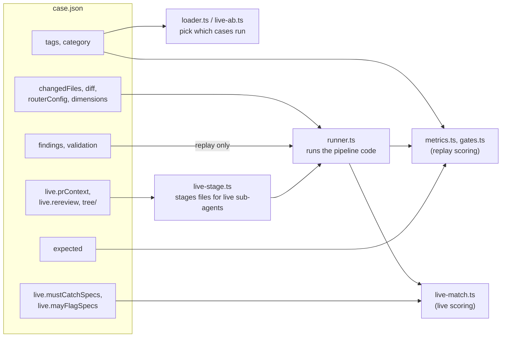

| Field | Read by | Contents |
|---|---|---|
| `tags` | `loader.ts`, `live-ab.ts` | `smoke` (24 cases: the per-PR subset), `live` (41: runnable with real models) |
| `category` | `metrics.ts`, `gates.ts` | `incident-repro` (19), `clean` (16), `golden` (12), `synthetic-mutation` (12), `adversarial-injection` (3). Some metrics apply only to one category (e.g. clean false-block rate) |
| `changedFiles`, `routerConfig` | `runner.ts` → `route` | the PR's files and the repo's routing rules |
| `diff` | `runner.ts`, `live-stage.ts` | the PR diff |
| `dimensions` | `runner.ts` → verdict | which review passes ran |
| `findings` | `runner.ts` (replay) | saved sub-agent findings |
| `validation` | `runner.ts` (replay) | saved claim-validator decisions (21 cases) |
| `expected` | `metrics.ts` | the right verdict and comment count; finding ids that must / must not post |
| `live.prContext`, `tree/` | `live-stage.ts` | PR title/description and the code snapshot sub-agents read |
| `live.rereview` | `live-stage.ts` | an earlier review and push, for re-review cases (3 cases) |
| `live.mustCatchSpecs` | `live-match.ts` | defects that must be found: path, line window, wording patterns, owning lens |
| `live.mayFlagSpecs` | `live-match.ts` | real defects that aren't the target; matching one isn't counted as noise |

## 3.3 How inputs are provided

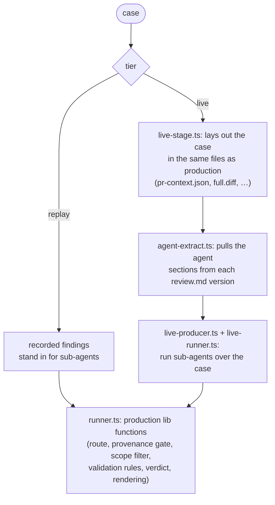

Live arms differ from production in ways `live-producer.ts` documents, each with
a reason:

| Difference | Reason given |
|---|---|
| no `thread-reconciler` | eval cases have no open threads |
| no `pattern-triage` | every changed file in a case is worth reviewing |
| tools limited to Read/Grep/Glob, plus a hook blocking reads outside the case (`read-scope.ts`) | the corpus and scorer sit on the same machine; a reviewer once read its own answers |
| `{{#runtime-import}}` lines resolve against the case's `tree/` | no consumer repo exists in the eval |

Some of these have costs; see "Eval" under Problems.

## 3.4 How outputs are judged

| Tier | Scoring | Model involved |
|---|---|---|
| Replay | `metrics.ts`: must-catch recall, golden precision, clean false-block rate, noise, confidence calibration. `gates.ts`: holdout-vs-training gap, and an adversarial hard gate | none |
| Live | `live-match.ts`: a finding matches a spec when its path/line agree and a wording pattern hits. Specs left unmatched go to `match-arbiter.ts`; its matches are marked `via: "fallback"`. Unmatched findings are noise unless they match a may-flag spec or duplicate a match | Haiku arbiter (yes/no per finding) |
| Live A/B, judged replay | `judge.ts`: scores the quality of each posted comment | Haiku judge |

The live A/B is report-only with one exception: if the PR's version fails an
adversarial case (best of three retries), the run fails. `aggregate.ts` pools
repeated runs into per-case rates with confidence intervals; the README's noise
floor says single-run differences inside those bands mean nothing.

## 3.5 How they run

| Workflow | Trigger | Runs |
|---|---|---|
| `review-eval-ab.yml` | PRs touching `workflows/review/**` (smoke subset; `full-eval` label for all live cases); manual dispatch for repeated runs | `live-ab.ts` |
| `review-eval-drift.yml` | weekly; manual | `live-ab.ts`, both arms on main, full corpus ×3 |
| `review-eval-full.yml` | weekly; `live-judge` label | `live-judge.ts` |
| `review-rereview-sweep.yml` | `rereview-sweep` label; manual | `rereview-sweep.ts` |

Every live workflow first runs `live-runner.ts --probe-read-scope`, which checks
the read-scope hook actually blocks reads outside the case. Spend is capped
per run (`--max-usd`).

---

# Problems and possible solutions

Each problem is checked against the code; solutions are directions, not designs.

## Rules reach reviewers in too many ways (see 2.2)

**Lens files hold codebase knowledge only the reviewer can see.** They are
pasted into one specialist's prompt, but their content is useful to anyone
writing code. Webapp's only lens file, `lenses/security-auth.md`, lists
trust-boundary rules with file pointers (which request headers may be
trusted, how task-only routes must be gated).
*Solution:* move lens content into the repo's real skills and retire lens files.
Note this makes the rules stricter: skill rules must be quoted exactly to count.

**The skills index duplicates the skills.** `skills.md` repeats each skill's path and adds
bot-only "evaluate when" triggers; the skills themselves (webapp's
`.claude/skills/`, also linked as `.agents/skills`) already describe when they apply.
*Solution:* pick skills from each skill file's own description and drop the index.

**Built-in specialist rules use a different format from skills.**
*Solution:* ship them as built-in skills, so there is one format, one way of
loading rules, and one level of strictness.

## The prompt file is large and repetitive

**All instructions live in one ~3,800-line `review.md`.** The 11 specialist
sections (~840 lines) share one shape (rules, hunts, repo add-ons, output).
*Solution:* generate specialist sections from data.

**The same text is pasted in many places.** The skills index is imported into
13 prompts, and whole-change reviewers (e.g. `skill-auditor`) carry their own
edited copies of the shared disciplines.
*Solution:* stage each once to a file, as `disciplines.md` already is.

**Some rule-based steps are still prose for the orchestrator.** The early-exit
check (Step 2) and choosing team reviewers (Step 8: risky files → owning teams,
minus teams already requested or already reviewed) are fixed rules the
orchestrator is asked to follow, unlike the steps already moved into scripts.
*Solution:* move them into code (see Option A).

## Stale and misleading text

**Comments describe a removed `task` dispatch mode** (the old Task-tool path,
e.g. `dispatch.ts`, `router.ts`, `dispatch-runner.ts`). Only `scripted` exists
in code.
*Solution:* delete the references.

**Code comments mostly record history and past incidents** rather than the
current design.
*Solution:* move history to the changelog; keep comments about current behaviour.

## Code structure

**Shared files have no shared types.** Scripts hand off through JSON files, and
the writer usually exports a type (`RoutingJson` in `router.ts`,
`DispatchResult` in `dispatch.ts`), but no other script imports it. Each
reader instead casts the file to its own partial shape, inline. For example,
`submission.ts`, `version-footer.ts` and `cache-record.ts` each declare their own
fragment of `dispatch-result.json`. A writer can rename a field without the
compiler noticing any reader.
*Solution:* one module per handoff file that owns its path, type and reader;
every script imports it.

**Every script rebuilds the same plumbing.** `/tmp/gh-aw/review` is defined
separately in 16 files, `readJson` in 5, and each CLI has its own filesystem type
(`DispatchFs`, `SubmissionFs`, `StagePrFs`, …).
*Solution:* one shared file-access module.

**Files are opened far from the step that owns them.** `routing.json` is opened
by path in 9 modules, `rereview-plan.json` in 8, `dispatch-result.json` in 8,
including helpers like `version-footer.ts` and `investigation-cap.ts`. So any
module can quietly depend on any step's output.
*Solution:* read each file once per script and pass the values down as arguments.

**The review depth has two sources of truth.** `rereview-plan.json` holds it, but
`dispatch.ts` can rewrite that plan (escalation) and also records the depth in
`dispatch-result.json`. Later modules read it from one or the other, e.g.
`version-footer.ts` reads it from `dispatch-result.json`.
*Solution:* make one file authoritative and have every reader use it.

**Helpers live in whichever module needed them first.** Comment-label parsing
(`isBlockingLabel` in `render-comment.ts`, `parseLeadingLabel` in `rereview.ts`)
is imported by `dispatch-gate.ts` and `dispatch-escalation.ts`. The risks comment's
signature (`computeRisksPatternsKey`) lives in `cache-record.ts` but is computed
by `submission.ts`.
*Solution:* move shared helpers into small modules named for what they do.

**Module boundaries follow a line-count rule, not responsibilities.** The five
largest files sit at 992–999 lines, just under a 1,000-line lint cap, and many
modules say in their header that they were split out to stay under it
(`dispatch-agents.ts`, `forwarded-warnings.ts`, `stage-pr-cli.ts`, …).
*Solution:* split by responsibility (e.g. per pipeline stage), then let size follow.

## Eval

**The eval doesn't run the production pipeline.** Neither tier calls
`runDispatch` or `runSubmissionCli`. `runner.ts` recombines lib functions itself,
and live arms use their own sub-agent runner (`live-runner.ts`, separate from
`dispatch-runner.ts`) and their own `## agent:` extractor (`agent-extract.ts`).
Changes to how `dispatch.ts` or `submission.ts` wire things together go
untested, and the copies drift: `live-producer.ts` redefines `DEFAULT_FINDERS`
instead of importing it from `dispatch-roster.ts`.
*Solution:* make `runDispatch` and `runSubmissionCli` the eval's entry points,
with the model runner and file paths injected.

**Live sub-agents run under different tools than production.** Production allows
Read/Grep/Glob/LS/Bash; the eval allows Read/Grep/Glob, so `investigation-cap.ts`
is unreachable and the cap's fallback path is what's measured.
*Solution:* share one tool policy (and one cap hook) between both runners.

**Stale header in `judge.ts`.** It describes an "Opus-4.8 judge"; the pinned model
is `claude-haiku-4-5-20251001`.
*Solution:* fix the comment.

## Possible bugs

**Config warnings may never reach the PR.** Lens-file and ROUTING warnings land
in `routing.json`, and the prompt tells the orchestrator to show them. But
`submission.ts` (which writes the review body the orchestrator must post
exactly) doesn't read them.
*Solution:* confirm, then have `submission.ts` render them.

**The investigation cap depends on the sub-agent asking.** Each sub-agent is
told to run `investigation-cap.ts request <id>` before every investigation tool
call; the code only refuses when asked. A sub-agent that skips the call is
never capped. `dispatch-runner.ts` already uses an SDK hook to force
`submit_result`.
*Solution:* enforce the cap the same way, with a hook on each tool call.

---

# Options beyond gh-aw

High-level options, not plans. Today gh-aw provides five things the bot relies on:
it runs the orchestrator from `review.md`, posts through a separate job holding
the write token, meters and caps AI spend, keeps cache memory between runs, and
assembles prompts from the repo's config files. Consumers install the bot by
importing `review.md`.

## Option A: a deterministic pipeline with no orchestrator

The orchestrator already does little beyond running scripts in order. What it
still does:

| Orchestrator task | Kind of work | Without an orchestrator |
|---|---|---|
| Early-exit check (Step 2: merge commit with an unchanged diff) | fixed rules, written as prose | code |
| Run `dispatch.ts`, `submission.ts`, `notified.ts`, `cache-record.ts` | sequencing | code |
| Emit safe outputs exactly as `submission-plan.json` says | copying | code calls the GitHub API |
| Answer `pendingRiskQuestions` (tighten or loosen?) | judgment | one small sub-agent call |
| Write `author-disputes.json` from reply chains | judgment | one small sub-agent call |
| Risks comment and team reviewers (Steps 7–8) | mostly rules in prose | code |

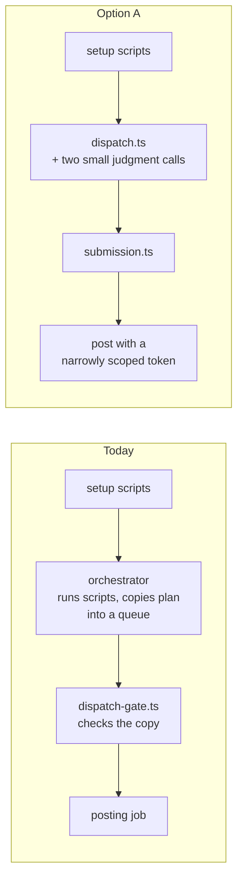

**What could be deleted**, because it exists only to manage the orchestrator:
- `dispatch-gate.ts` and `dispatch-gate-plan.ts` (about 1,300 lines), which check
  the orchestrator copied the plan faithfully.
- The 60-minute Bash ceiling and the one-blocking-call rule for `dispatch.ts`.
- The "died mid-dispatch" fallback comment, and `cache-record.ts` reading the
  queue to detect that case.
- The out-of-reach copy of `lib/` for post-agent steps.
- Most of the orchestrator half of `review.md` (Steps 1–9).

**What would need replacing:** a posting step that keeps write access away from
the AI steps, a spend cap, storage for PR memory, loading the repo's config
files into prompts, and a way for consumers to install it (e.g. a reusable
workflow).

## Option B: run sub-agents on pi instead of the Claude Agent SDK

Sub-agents already run outside gh-aw: `dispatch-runner.ts` starts each one with
the Claude Agent SDK, adds a custom `submit_result` tool, and uses a hook to force
it to be called. pi's SDK covers the same ground, plus:
- **Extensions with tool-call hooks** that can block a call, so limits like the
  investigation cap run inside the agent instead of relying on it asking.
- **Many model providers** through one interface.

**Durable sessions (`@earendil-works/pi-durable`, experimental).** It saves every
turn and tool call to storage and resumes after the process dies. That targets a
real failure: runs killed at the time limit during claim validation posted
nothing (run 32418662895), and `dispatch.ts` writes each sub-agent's output to
`out/` but never reuses it on a rerun. Checkpoints would only help if they
outlive the job, though (all run state lives in `/tmp` on the runner).
A cheaper first step is reusing finished `out/` results on retry.

# Next sections (to be written)

Each will go one level deeper into Part 1: preparing the PR, routing,
the review pipeline, verdict rules, follow-up reviews, and safety checks.
